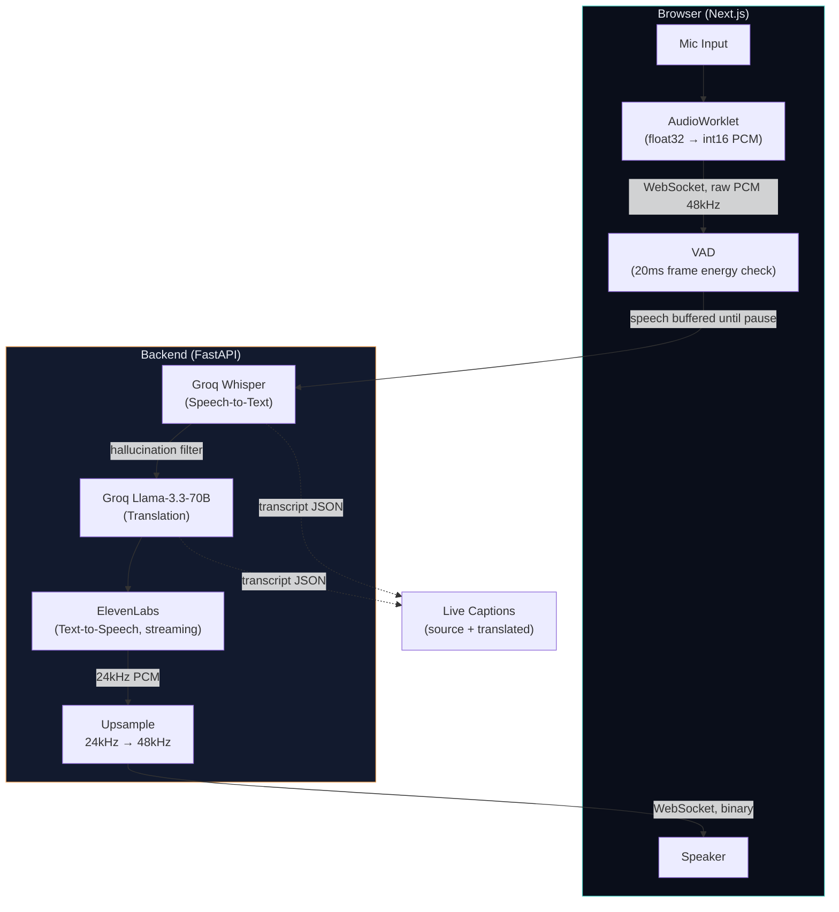

# Real-Time AI Voice Translator

Speak into your mic, hear it translated live in another language — with
live captions showing both the original and translated text.

**Pipeline:** Browser mic → WebSocket → VAD (silence detection) → Groq Whisper (STT) → Groq Llama (MT) → ElevenLabs (TTS) → Browser speaker

## Features

- Real-time speech translation across 8 languages (English, Hindi, Tamil, Telugu, Spanish, French, German, Japanese)
- Speech-triggered chunking (VAD) — cuts on natural pauses, not arbitrary timers
- Live captions with source (original) and translated text side by side
- Custom dark-glass UI with a live waveform visualizer that reacts to your voice
- Fully self-hosted pipeline — no black-box translation API, every stage is independently swappable

## Architecture



**Why this over a single black-box API (e.g. Gemini Live):** each stage
(STT / MT / TTS) is independently debuggable and swappable, and it matches
an existing Groq-based tech stack for a consistent story across projects.

**Why VAD instead of a fixed timer:** an earlier version buffered audio in
fixed 3-second windows. That cut sentences mid-word and sent pure-silence
chunks to Whisper, which hallucinated filler text instead of returning
empty. VAD (Voice Activity Detection) buffers speech until a natural pause
is detected — a far better sentence boundary than an arbitrary clock.

## Tech Stack

| Stage | Technology | Why |
|---|---|---|
| STT | Groq Whisper (`whisper-large-v3-turbo`) | Fast, same provider as MT — one API key |
| MT | Groq Llama (`llama-3.3-70b-versatile`) | Full prompt control vs. a black-box translate model |
| TTS | ElevenLabs (streaming, `pcm_24000`) | Natural voice quality, streaming reduces perceived latency |
| VAD | Custom RMS-energy detector | Cheap, fast, no extra ML dependency |
| Backend | FastAPI + WebSocket | Native async WebSocket support, unlike serverless platforms |
| Frontend | Next.js 14 + Web Audio API | AudioWorklet for mic capture, no WebRTC/STUN/TURN needed (not peer-to-peer) |

## Local Setup

### Backend

```bash
cd backend
python -m venv .venv
source .venv/bin/activate   # Windows: .venv\Scripts\activate
pip install -r requirements.txt
cp .env.example .env
```

Edit `.env` and add your keys:
GROQ_API_KEY=your_groq_key          # console.groq.com - free
ELEVENLABS_API_KEY=your_11labs_key  # elevenlabs.io - free tier

**Important — ElevenLabs voice setup:** the free-tier API cannot use
ElevenLabs' default library voices (e.g. "Rachel") — that returns a
`402 Payment Required` error. You must add a voice to your own account
first:
1. Go to `elevenlabs.io/app/voice-library`
2. Pick any voice → **"Add to my voices"** (free)
3. Copy its Voice ID from **My Voices**
4. Paste it into `config.py`:
```python
   TTS_VOICE_ID: str = "your_added_voice_id_here"
```

Start the server:
```bash
uvicorn src.main:app --reload --port 8000
```

Verify: open `http://localhost:8000/health` → should return `{"status": "ok"}`

### Frontend

```bash
cd frontend
npm install
cp .env.local.example .env.local
npm run dev
```

Open `http://localhost:3000`, allow mic permission, pick a target language, tap "Start Speaking".

## Deployment

### Backend → Railway

1. Push `backend/` to a GitHub repo (root directory `backend` if monorepo).
2. Railway: New Project → Deploy from GitHub repo.
3. Add environment variables: `GROQ_API_KEY`, `ELEVENLABS_API_KEY`.
4. Railway auto-detects `railway.toml` and runs the start command.

**Why Railway, not Vercel, for the backend:** this app holds a persistent
WebSocket connection per session. Vercel's serverless functions have
execution time limits and don't support long-lived connections — Railway
runs it as a normal long-running process.

### Frontend → Vercel

1. Push `frontend/` to GitHub (root directory `frontend` if monorepo).
2. Import into Vercel.
3. Add environment variable:

NEXT_PUBLIC_WS_URL=wss://your-app.up.railway.app/ws/translate

(`wss://` not `ws://` — Railway serves HTTPS, so the WebSocket must be secure too.)
4. Deploy.

### CORS note

`backend/src/main.py` currently allows all origins (`allow_origins=["*"]`)
for easy local dev. Before production, restrict it:
```python
allow_origins=["https://your-frontend.vercel.app"]
```

## Tuning Knobs (`config.py`)

| Constant | Default | What it controls |
|---|---|---|
| `VAD_SILENCE_THRESHOLD` | `700` | RMS level below which audio is treated as silence. Raise if background noise triggers false speech detection; lower if quiet speech is missed. |
| `VAD_SILENCE_DURATION_MS` | `600` | How long a pause must last before flushing the buffered speech to STT. Lower = faster feel but risks cutting mid-sentence. |
| `VAD_MAX_CHUNK_SECONDS` | `8.0` | Safety cap — flushes even without a pause, so continuous speech doesn't stall the pipeline indefinitely. |
| `VAD_MIN_CHUNK_SECONDS` | `0.3` | Minimum speech length to bother sending to Whisper — filters out coughs/clicks. |
| `TTS_VOICE_ID` | your added voice | Swap for a different ElevenLabs voice (must be in your account — see setup above). |
| `LANGUAGES` | 8 languages | Add/remove target languages shown in the UI dropdown. |

## Known Limitations

- ElevenLabs free tier caps at ~10k characters/month — fine for demos/portfolio, not sustained heavy use.
- No reconnection logic on WebSocket drop — refresh the page to restart a session.
- Whisper occasionally hallucinates common phrases (e.g. "Thank you.") on very quiet audio even with VAD active. A known-phrase filter (`_WHISPER_HALLUCINATIONS` in `pipeline.py`) catches the most common ones, but it's not exhaustive.
- VAD threshold (`VAD_SILENCE_THRESHOLD`) is mic/room dependent — may need retuning on a different device or noisy environment.

## Troubleshooting

**`ModuleNotFoundError` after `pip install` on Windows, or install fails
partway through:** Windows has a default 260-character path length limit.
Some packages (e.g. `elevenlabs`) have long auto-generated filenames that
exceed it when combined with a deep folder path. Fix: enable Windows Long
Path support (`regedit` → `HKEY_LOCAL_MACHINE\SYSTEM\CurrentControlSet\Control\FileSystem`
→ set `LongPathsEnabled` to `1` → restart), then delete and recreate
`.venv` from scratch (never move/copy an existing `.venv` — its launcher
scripts hardcode the original path and break if relocated).

**`402 Payment Required` from ElevenLabs:** you're using a library voice
ID (e.g. Rachel's `21m00Tcm4TlvDq8ikWAM`) which requires a paid plan via
API. See the ElevenLabs voice setup step above.

**Garbled/empty transcripts, or "." appearing as a transcript:** this was
an issue with the original fixed-3-second chunking approach — fixed by
switching to VAD-based speech-triggered chunking (see Architecture above).