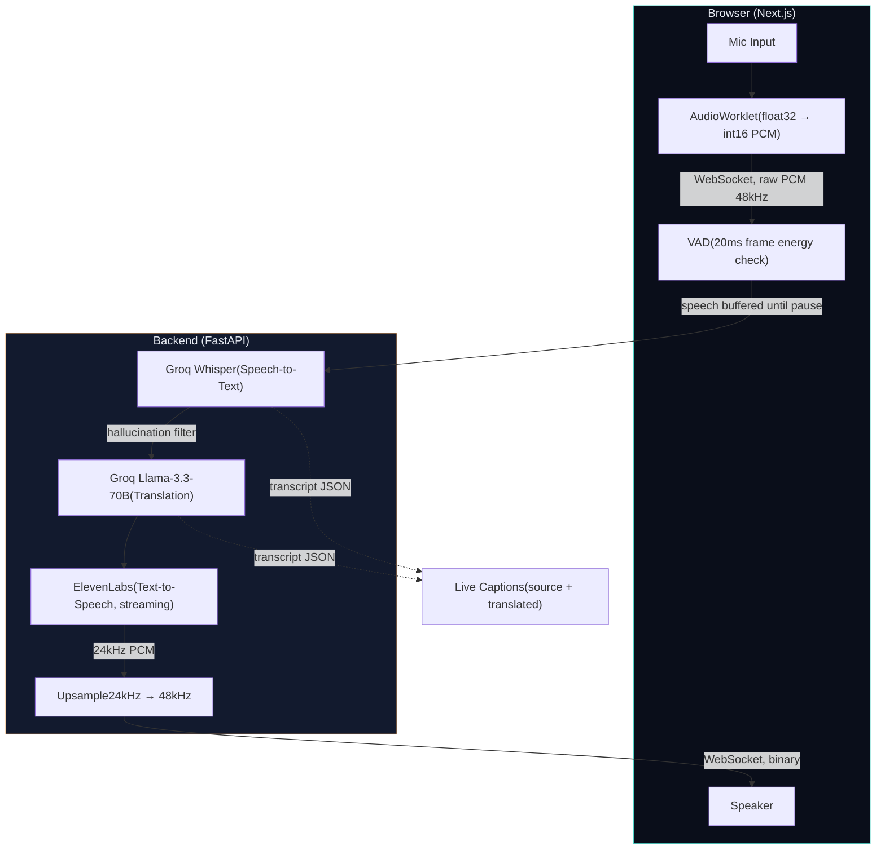

# 🎙️ Real-Time AI Voice Translator

Speak into your mic, hear it translated live in another language — with
live captions showing both the original and translated text.

**Live demo:** Backend → `https://Real-Time-AI-Voice-Translator.onrender.com` · Frontend → *(add your Vercel URL here)*

---

## ✨ Features

- Real-time speech translation across 8 languages (English, Hindi, Tamil, Telugu, Spanish, French, German, Japanese)
- Speech-triggered chunking (VAD) — cuts on natural pauses, not arbitrary timers
- Live captions with source (original) and translated text side by side
- Custom dark-glass UI with a live waveform visualizer that reacts to your voice
- Fully self-hosted pipeline — no black-box translation API, every stage is independently swappable and debuggable

---

## 🏗️ Architecture



**Why this over a single black-box API (e.g. Gemini Live):** each stage
(STT / MT / TTS) is independently debuggable and swappable, and it matches
an existing Groq-based tech stack for a consistent story across projects.

**Why VAD instead of a fixed timer:** an earlier version buffered audio in
fixed 3-second windows. That cut sentences mid-word and sent pure-silence
chunks to Whisper, which hallucinated filler text instead of returning
empty. VAD (Voice Activity Detection) buffers speech until a natural pause
is detected — a far better sentence boundary than an arbitrary clock.

### How a single utterance flows through the system

1. **Capture** — browser mic streams audio via an `AudioWorklet` (converts float32 samples to int16 PCM on a separate audio thread, so the main UI thread never blocks).
2. **Transport in** — raw PCM streams to the backend over a WebSocket, as binary frames, 48kHz.
3. **VAD buffering** — the backend analyzes incoming audio in 20ms frames. It buffers while speech is detected and flushes the buffer once a ~600ms pause is found — this pause is the sentence boundary, not a fixed clock.
4. **STT** — the flushed chunk is downsampled 48kHz → 16kHz and sent to Groq Whisper for transcription.
5. **Hallucination filter** — Whisper occasionally returns filler text (e.g. `"."`, `"Thank you."`) on near-silent audio instead of empty text. A known-phrase filter catches these before they reach translation.
6. **MT** — the clean transcript is translated by Groq Llama, with a strict prompt that forces translation-only output (no commentary, no explanations).
7. **TTS** — the translated text is streamed to ElevenLabs, which returns 24kHz PCM audio in chunks as it's generated (not waiting for the full sentence).
8. **Transport out** — each TTS chunk is upsampled 24kHz → 48kHz and streamed back over the same WebSocket as binary frames; the browser schedules them for gapless playback.
9. **Captions** — transcript text (source + translated) is sent alongside as JSON, rendered as live captions in the UI.

### Why this design, not a single black-box API (e.g. Gemini Live)

Each stage (STT / MT / TTS) is independently debuggable and swappable — if translation quality is off, you can test the MT stage alone without touching STT or TTS. It also reuses one provider (Groq) for two of the three stages, keeping the API surface and cost story simple.

### Why VAD instead of a fixed timer

An earlier version buffered audio in fixed 3-second windows. That cut sentences mid-word regardless of what was being said, and sent pure-silence chunks to Whisper, which hallucinated filler text instead of returning empty. VAD buffers speech until a natural pause is detected — a far better sentence boundary than an arbitrary clock, and it also means silence costs nothing (no STT/MT/TTS calls wasted on dead air).

---

## 🧰 Tech Stack

| Stage | Technology | Why |
|---|---|---|
| STT | Groq Whisper (`whisper-large-v3-turbo`) | Fast, same provider as MT — one API key |
| MT | Groq Llama (`llama-3.3-70b-versatile`) | Full prompt control vs. a black-box translate model |
| TTS | ElevenLabs (streaming, `pcm_24000`) | Natural voice quality, streaming reduces perceived latency |
| VAD | Custom RMS-energy detector | Cheap, fast, no extra ML dependency |
| Backend | FastAPI + WebSocket | Native async WebSocket support, unlike serverless platforms |
| Backend hosting | Render | Persistent process, required for long-lived WebSocket connections |
| Frontend | Next.js 14 + Web Audio API | AudioWorklet for mic capture — no WebRTC/STUN/TURN needed since audio goes client→own-server, not peer-to-peer |
| Frontend hosting | Vercel | Standard Next.js deployment target |

---

## ⚙️ Local Setup

### Backend

```bash
cd backend
python -m venv .venv
source .venv/bin/activate   # Windows: .venv\Scripts\activate
pip install -r requirements.txt
cp .env.example .env
```

Edit `.env` and add your keys:

GROQ_API_KEY=your_groq_key          # console.groq.com - free
ELEVENLABS_API_KEY=your_11labs_key  # elevenlabs.io - free tier

**Important — ElevenLabs voice setup:** the free-tier API cannot use
ElevenLabs' default library voices (e.g. "Rachel") — that returns a
`402 Payment Required` error. You must add a voice to your own account first:
1. Go to `elevenlabs.io/app/voice-library`
2. Pick any voice → **"Add to my voices"** (free)
3. Copy its Voice ID from **My Voices**
4. Paste it into `config.py`:
```python
   TTS_VOICE_ID: str = "your_added_voice_id_here"
```

Start the server:
```bash
uvicorn src.main:app --reload --port 8000
```

Verify: open `http://localhost:8000/health` → should return `{"status": "ok"}`

### Frontend

```bash
cd frontend
npm install
cp .env.local.example .env.local
npm run dev
```

Open `http://localhost:3000`, allow mic permission, pick a target language, tap "Start Speaking".

---

## 🚀 Deployment

### Backend → Render

1. `render.com` → sign in with GitHub → **New +** → **Web Service**
2. Select the `Real-Time-AI-Voice-Translator` repo
3. **Root Directory:** `backend` (monorepo — Render needs to know which folder to build)
4. **Build Command:** `pip install -r requirements.txt`
5. **Start Command:** `uvicorn src.main:app --host 0.0.0.0 --port $PORT`
6. **Environment Variables:** add `GROQ_API_KEY`, `ELEVENLABS_API_KEY`
7. **Instance Type:** Free
8. Deploy — verify at `https://your-app.onrender.com/health`

**Why Render, not Vercel, for the backend:** this app holds a persistent
WebSocket connection per session. Vercel's serverless functions have
execution time limits and don't support long-lived connections — Render
runs it as a normal long-running process.

**Free tier note:** Render's free instances sleep after 15 minutes of
inactivity. The first request after sleeping takes ~30-50s to wake up —
fine for demos/portfolio, not for production.

### Frontend → Vercel

1. `vercel.com` → **Add New** → **Project** → select the repo
2. **Root Directory:** `frontend`
3. **Environment Variable:**

NEXT_PUBLIC_WS_URL=wss://your-app.onrender.com/ws/translate

(`wss://` not `ws://` — the backend is served over HTTPS, so the browser will block an insecure WebSocket as mixed content.)
4. Deploy

### CORS

`backend/src/main.py` currently allows all origins (`allow_origins=["*"]`)
for easy local dev. After the Vercel URL is live, restrict it:
```python
allow_origins=["https://your-frontend.vercel.app"]
```
Commit and push — Render auto-redeploys on push.

---

## 🎛️ Tuning Knobs (`config.py`)

| Constant | Default | What it controls |
|---|---|---|
| `VAD_SILENCE_THRESHOLD` | `700` | RMS level below which audio is treated as silence. Raise if background noise triggers false speech detection; lower if quiet speech is missed. |
| `VAD_SILENCE_DURATION_MS` | `600` | How long a pause must last before flushing buffered speech to STT. Lower = faster feel but risks cutting mid-sentence. |
| `VAD_MAX_CHUNK_SECONDS` | `8.0` | Safety cap — flushes even without a pause, so continuous speech doesn't stall the pipeline indefinitely. |
| `VAD_MIN_CHUNK_SECONDS` | `0.3` | Minimum speech length to bother sending to Whisper — filters out coughs/clicks. |
| `TTS_VOICE_ID` | your added voice | Swap for a different ElevenLabs voice (must be in your account — see setup above). |
| `LANGUAGES` | 8 languages | Add/remove target languages shown in the UI dropdown. |

---

## ⚠️ Known Limitations

- ElevenLabs free tier caps at ~10k characters/month — fine for demos/portfolio, not sustained heavy use.
- No reconnection logic on WebSocket drop — refresh the page to restart a session.
- Whisper occasionally hallucinates common phrases (e.g. "Thank you.") on very quiet audio even with VAD active. A known-phrase filter (`_WHISPER_HALLUCINATIONS` in `pipeline.py`) catches the most common ones, but it's not exhaustive.
- VAD threshold (`VAD_SILENCE_THRESHOLD`) is mic/room dependent — may need retuning on a different device or noisy environment.
- Render's free tier sleeps after inactivity — first request after idle takes ~30-50s.

---

## 🛠️ Troubleshooting

**`ModuleNotFoundError` after `pip install` on Windows, or install fails
partway through:** Windows has a default 260-character path length limit.
Some packages (e.g. `elevenlabs`) have long auto-generated filenames that
exceed it when combined with a deep folder path. Fix: enable Windows Long
Path support (`regedit` → `HKEY_LOCAL_MACHINE\SYSTEM\CurrentControlSet\Control\FileSystem`
→ set `LongPathsEnabled` to `1` → restart), then delete and recreate
`.venv` from scratch (never move/copy an existing `.venv` — its launcher
scripts hardcode the original path and break if relocated).

**`402 Payment Required` from ElevenLabs:** you're using a library voice
ID (e.g. Rachel's `21m00Tcm4TlvDq8ikWAM`) which requires a paid plan via
API. See the ElevenLabs voice setup step above.

**Garbled/empty transcripts, or "." appearing as a transcript:** this was
an issue with the original fixed-3-second chunking approach — fixed by
switching to VAD-based speech-triggered chunking (see Architecture above).

**Mixed content / WebSocket connection blocked in production:** the
frontend is using `ws://` instead of `wss://` for a backend served over
HTTPS. Update `NEXT_PUBLIC_WS_URL` to use `wss://`.
