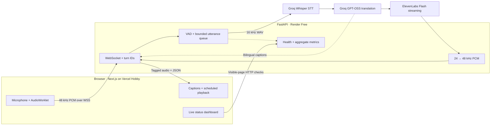

<div align="center">

# 🎙️ Real-Time AI Voice Translator

### Two-way voice translation with streaming audio, bilingual captions, and live system metrics

<p align="center">
  <b>Speak, pause, and hear your words in another language.</b><br/>
  A working portfolio demo built with Next.js, FastAPI, Groq, and ElevenLabs.
</p>

[](https://python.org)
[](https://fastapi.tiangolo.com)
[](https://nextjs.org)
[](https://groq.com)
[](https://elevenlabs.io)
[](LICENSE)

<br/>

### [▶ Try the live translator](https://real-time-ai-voice-translator.vercel.app) &nbsp; · &nbsp; [▶ Open the live dashboard](https://real-time-ai-voice-translator.vercel.app/status)

**Vercel Hobby · Render Free · Groq Free · ElevenLabs Free**

<p align="center">
  <a href="#-key-features">Features</a> •
  <a href="#-architecture">Architecture</a> •
  <a href="#-how-it-works">How It Works</a> •
  <a href="#-local-setup">Local Setup</a> •
  <a href="#-deployment">Deployment</a> •
  <a href="#-verification">Verification</a> •
  <a href="docs/README.md">Documentation</a>
</p>

</div>

---

> [!NOTE]
> **Trying the demo:** choose both languages, click **Start speaking**, allow microphone access, and pause after a sentence. Use headphones. The free backend may take about a minute to wake up; the UI shows connection progress before requesting your microphone.

## ✨ Key Features

- 🌐 **Seven languages:** English, Hindi, Tamil, Spanish, French, German, and Japanese, selectable as source and target.
- 🔁 **Two-way conversation:** **Switch speaker** swaps the language direction on the same microphone and WebSocket connection. Earlier captions remain visible.
- ⚡ **Controlled interruption:** **Interrupt & speak** stops scheduled playback immediately and starts a new turn in the current direction. Turn IDs reject stale captions/audio; a bounded microphone pre-roll preserves recent speech during the switch.
- 🔊 **Streaming voice output:** ElevenLabs Flash v2.5 returns PCM through its streaming endpoint. Playback begins before the entire response finishes generating.
- 💬 **Bilingual captions and replay:** source and translated text appear side by side. Copy captions or replay received audio without another API request.
- 🎛️ **Light, responsive interface:** clear microphone controls, live input visualization, keyboard-accessible selectors, playback/status indicators, and actionable error states.
- 📊 **Measured observability:** per-turn timings plus a live dashboard for stage latency, p50/p95, sample counts, capacity, outcomes, budgets, and provider observations.
- 🛡️ **Free-demo safeguards:** bounded queues, finite provider timeouts, per-visitor start limits, request/character budgets, and reliable microphone/session cleanup.

Translation is **utterance-based**: the system buffers speech until a pause or an eight-second boundary. Two-way interaction uses explicit speaker controls; automatic acoustic barge-in and simultaneous speaker separation are outside this version.

## 🏗️ Architecture

The stages remain separate so transport, recognition, translation, synthesis, and playback can be measured independently.



See [system design and WebSocket protocol](docs/ARCHITECTURE.md) for turn switching, cancellation, audio formats, and measurement boundaries.

## 🔬 How It Works

1. **Capture:** an `AudioWorklet` converts 48 kHz mono microphone samples into 20 ms signed 16-bit PCM frames. The frontend adds a turn ID and browser speech timestamp before sending each packet.
2. **Detect a turn:** the backend checks frame RMS energy. It buffers speech until roughly 600 ms of silence, with a minimum speech duration and an eight-second safety boundary.
3. **Recognize:** anti-aliased polyphase resampling converts the utterance to 16 kHz WAV in memory. Groq Whisper receives the selected source-language hint. Empty text and a small set of known silence/outro artifacts are filtered.
4. **Translate:** Groq `openai/gpt-oss-20b` returns translation text using a strict translation-only prompt. Captions are sent before synthesis completes.
5. **Synthesize and play:** ElevenLabs `eleven_flash_v2_5` streams 24 kHz PCM. The server repeats samples to produce 48 kHz PCM; the browser schedules the arriving chunks with Web Audio.
6. **Change speakers:** an explicit control stops old playback, changes the turn epoch, and acknowledges the new direction. Old results are discarded. Already-issued provider work finishes within its timeout before the single session worker advances.
7. **Measure:** server stage durations and browser scheduled-playback timing are reported separately. Structured logs and bounded in-memory metrics contain operational data without conversation content.

Normal microphone forwarding pauses during translated playback to reduce feedback. Capture remains available for an explicit interruption; headphones are recommended.

## 🧰 Tech Stack

| Layer | Technology | Role |
| --- | --- | --- |
| Frontend | Next.js 16.4.2, React 19, TypeScript | Responsive translator and monitoring routes |
| Browser audio | AudioWorklet, Web Audio API | PCM capture, visualization, scheduled playback and replay |
| Backend | Python 3.12, FastAPI, Uvicorn | Async WebSocket transport; provider work off the event loop |
| Speech recognition | Groq `whisper-large-v3-turbo` | Utterance transcription with explicit language hints |
| Translation | Groq `openai/gpt-oss-20b` | Translation-only text output |
| Voice synthesis | ElevenLabs `eleven_flash_v2_5` | Streaming PCM with a verified built-in voice |
| Audio processing | NumPy, SciPy, RMS VAD | Speech boundaries and anti-aliased STT resampling |
| Observability | Process-local metrics, JSON event logs | Stage timings, outcomes, capacity and sanitized errors |

The original Llama model was unavailable on the deployment account, so the deployed configuration uses the verified free GPT-OSS alternative. `MT_MODEL` and `TTS_MODEL` remain configurable; there is no automatic paid fallback.

## ⚙️ Local Setup

Use **Python 3.12**, **Node.js 20.9+** and npm. You need Groq and ElevenLabs API keys plus a voice accessible on your ElevenLabs Free account. Configure secrets locally or in Render, never in frontend code.

### 1. Start the backend

From the repository root:

```bash
cd backend
python -m venv .venv
source .venv/bin/activate  # Windows PowerShell: .venv\Scripts\Activate.ps1
pip install -r requirements.txt
cp .env.example .env
```

Edit the ignored `backend/.env`:

```dotenv
GROQ_API_KEY=your_groq_api_key
ELEVENLABS_API_KEY=your_elevenlabs_api_key
TTS_VOICE_ID=your_compatible_free_voice_id
MT_MODEL=openai/gpt-oss-20b
TTS_MODEL=eleven_flash_v2_5
ALLOWED_ORIGINS=http://localhost:3000,http://127.0.0.1:3000
```

The deployed demo uses the built-in **Sarah** voice, `EXAVITQu4vr4xnSDxMaL`. Verify access in your own account: some library voices require a paid plan, and adding one to a collection does not guarantee Free synthesis access.

```bash
uvicorn src.main:app --reload --port 8000
```

Check [local health](http://localhost:8000/health) and [local configuration readiness](http://localhost:8000/ready). Readiness verifies configuration presence, not upstream credit or availability.

### 2. Start the frontend

In a second terminal, from the repository root:

```bash
cd frontend
npm ci
cp .env.local.example .env.local
npm run dev
```

The example sets `NEXT_PUBLIC_WS_URL=ws://localhost:8000/ws/translate`. Open **http://localhost:3000**, choose both languages, and click **Start speaking**. A secure HTTPS origin or localhost is required for browser microphone access.

More details: [frontend guide](frontend/README.md) · [backend guide](backend/README.md).

## 🚀 Deployment

| Component | Free service | Public entry point |
| --- | --- | --- |
| Translator | Vercel Hobby | [▶ Launch translator](https://real-time-ai-voice-translator.vercel.app) |
| Monitoring UI | Same Vercel project | [▶ View dashboard](https://real-time-ai-voice-translator.vercel.app/status) |
| FastAPI backend | Render Free | [Health](https://voice-translator-backend-u725.onrender.com/health) · [Readiness](https://voice-translator-backend-u725.onrender.com/ready) · [Metrics](https://voice-translator-backend-u725.onrender.com/metrics) |
| AI pipeline | Groq Free + ElevenLabs Free | Server-side credentials only |

Vercel builds the **`frontend`** directory with the Next.js preset. Render runs the **`backend`** directory as a Python web service. The persistent WebSocket backend runs on Render; Vercel serves the frontend and dashboard.

Production frontend configuration:

```dotenv
NEXT_PUBLIC_WS_URL=wss://voice-translator-backend-u725.onrender.com/ws/translate
```

Keep AI credentials in Render's environment. Set exact allowed frontend origins, `/health` as the service health check, and one Uvicorn worker for the process-local safeguards. The full commands, environment variables, cold-start behavior, and recovery steps are in [deployment and operations](docs/DEPLOYMENT.md).

Free tiers have request, credit, build and bandwidth limits. No paid resources or overage extension were enabled for this demo. Hosting/provider account settings and included allowances still determine availability; this is a non-commercial portfolio demo with ElevenLabs attribution.

## 📊 Observability & Latency

The [live dashboard](https://real-time-ai-voice-translator.vercel.app/status) shows:

- Active sessions and available capacity; completed, failed, empty and interrupted work.
- Successful outcome rate with its denominator stated explicitly.
- Latest, median and p95 stage durations with sample counts.
- Provider configuration versus actual success/error observations.
- Process-local voice/request budgets, uptime, audio bytes and recent sanitized errors.

It refreshes every 15 seconds while visible, pauses when hidden, and labels stale or failed checks. Monitoring does not call AI providers. Counters reset when the backend process restarts; it is not a historical uptime SLA or provider billing dashboard.

The final verified warm English→Hindi→English session measured **1.66 s / 1.68 s from speech end to scheduled browser playback**. These are two observations, not a latency guarantee; an earlier first-turn server observation was 3.49 s. See [verification results and measurement limits](docs/PRODUCTION_VERIFICATION.md).

## ✅ Verification

| Check | Recorded result |
| --- | --- |
| Backend unit/integration tests | 27 passed |
| AudioWorklet framing/flush tests | 2 passed |
| Browser regression scenarios | 9 passed on local and deployed frontend |
| Lint, TypeScript, production build | Passed |
| Automated desktop/mobile WCAG A/AA scan | Zero violations on translator and dashboard |
| Production dependency audit | Zero reported vulnerabilities |
| Real local/public API acceptance | English → Hindi → English, interruption, replay and microphone release |

Results were recorded on **2026-10-16**. Test commands and coverage boundaries are documented in [testing and verification](docs/TESTING.md). Browser regressions mock providers; the separate live acceptance used real provider responses. Physical microphone coverage and subjective translation/voice quality require manual evaluation.

## 🎛️ Tuning Knobs

| Configuration | Default | Purpose |
| --- | --- | --- |
| `MT_MODEL` / `TTS_MODEL` | GPT-OSS 20B / Flash v2.5 | Environment-selected provider models |
| `TTS_VOICE_ID` | Required | Free-compatible ElevenLabs voice |
| `MAX_SESSIONS` | `2` | Concurrent session capacity |
| `SESSION_SECONDS` / `SESSION_CHARACTERS` | `180` / `600` | Per-session time and voice-text budgets |
| `REQUESTS_PER_MINUTE` / `DAILY_CHARACTERS` | `15` / `1000` | Process-wide demo budgets |
| VAD threshold / silence duration | `700` / `600 ms` | Energy threshold and endpoint wait |
| VAD maximum / minimum speech | `8 s` / `0.3 s` | Utterance bounds |

Model and budget settings are environment variables. VAD constants and the seven-language menu are source settings in [`backend/src/config.py`](backend/src/config.py); they are not environment overrides. Keep the frontend language menu synchronized when changing supported languages.

## ⚠️ Known Limitations & Troubleshooting

<details>
<summary><b>The first connection is slow</b></summary>

Render Free sleeps after inactivity and can take about a minute to wake. The UI waits up to 90 seconds and shows a wake-up message. No artificial keep-alive service is configured. Check the dashboard or backend health before retrying.

</details>

<details>
<summary><b>A model, voice or free quota is unavailable</b></summary>

Provider HTTP 402/404 can indicate an unavailable model or voice; 429 indicates quota exhaustion. Verify account access and the configured model/voice instead of enabling a paid fallback. The UI reports sanitized errors; the dashboard records provider observations. Demo voice budgets count reserved text even if synthesis is interrupted or fails.

</details>

<details>
<summary><b>Microphone or WebSocket access fails</b></summary>

Allow microphone permission and use HTTPS or localhost. An HTTPS frontend requires `wss://` for its backend. Add the exact frontend origin to `ALLOWED_ORIGINS`; Vercel preview domains require explicit authorization. A public environment URL change requires rebuilding the frontend.

</details>

<details>
<summary><b>Speech overlaps playback or a speaker switch waits</b></summary>

Use headphones and the explicit interruption/speaker controls. Automatic acoustic interruption is not implemented. An already-issued provider request cannot be forcibly cancelled or refunded; its stale output is discarded, and new work may wait for that bounded call to finish. Stop and cancellation release the microphone; a new session is started manually after a disconnect, without replaying old captured audio.

</details>

The application stores no recordings or transcripts on its server. Providers receive audio/text to perform inference, and their data policies apply. Browser captions/replay are held in memory and are not durable history. Process-local limits are demo safeguards, not distributed abuse prevention. Development-only dependency advisories and other verification caveats are recorded in the [verification report](docs/PRODUCTION_VERIFICATION.md).

## 📚 Documentation

- [Documentation index](docs/README.md)
- [Architecture, audio formats and turn protocol](docs/ARCHITECTURE.md)
- [Deployment, configuration and operations](docs/DEPLOYMENT.md)
- [Testing and verification commands](docs/TESTING.md)
- [Recorded public acceptance and latency evidence](docs/PRODUCTION_VERIFICATION.md)

## 👤 Author

<div align="center">

### **Aayaann Kausar**

[](https://github.com/Akgithub2028)
[](https://github.com/Akgithub2028/Real-Time-AI-Voice-Translator)

</div>

## 📄 License

Source code is licensed under [MIT](LICENSE). External API terms apply separately. The deployed demo is non-commercial; generated voice is provided by [elevenlabs.io](https://elevenlabs.io).
