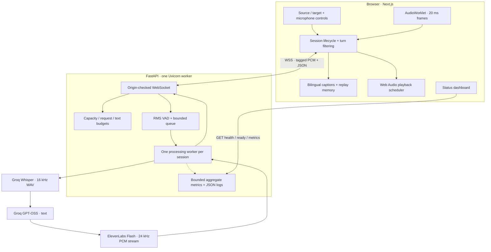
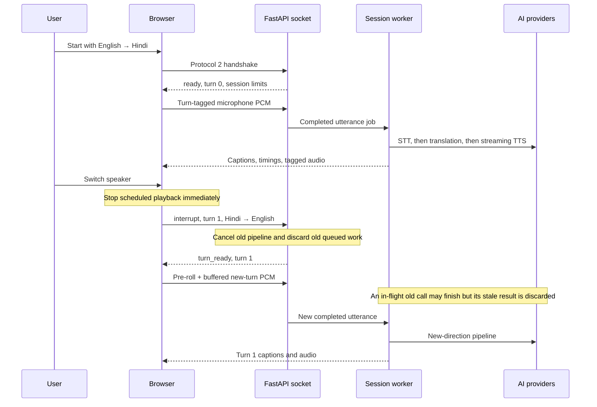

# System architecture

[Overview](../README.md) · [Deployment](DEPLOYMENT.md) · [Testing](TESTING.md)

## System boundary

The browser captures microphone PCM and exchanges audio and JSON events with a single FastAPI WebSocket session. Recognition, translation and synthesis are separate provider stages. The frontend runs on Vercel Hobby; the persistent backend runs on Render Free. No database, message broker or external monitoring service is required.



The monitoring arrow groups three HTTP endpoints; `/health` and `/ready` inspect liveness/configuration, while `/metrics` reads the aggregate monitor. None calls an AI provider.

## Responsibilities and source map

| Component | Source | Responsibility |
| --- | --- | --- |
| Translator view | [`frontend/app/page.tsx`](../frontend/app/page.tsx) | Controls, bilingual captions, status, replay and timing display |
| Session hook | [`frontend/hooks/use-translator.ts`](../frontend/hooks/use-translator.ts) | Capture lifecycle, socket generation/turn guards, interruption, playback and cleanup |
| Audio processor | [`frontend/public/pcm-processor.js`](../frontend/public/pcm-processor.js) | Float32→PCM16 conversion, 20 ms framing, partial-frame flush |
| Dashboard | [`frontend/app/status/page.tsx`](../frontend/app/status/page.tsx) | Visible-page polling, real measurements and stale/error states |
| Transport | [`backend/src/main.py`](../backend/src/main.py) | Handshake, origin checking, queue/worker ownership, protocol, error mapping and session cleanup |
| Pipeline | [`backend/src/pipeline.py`](../backend/src/pipeline.py) | VAD buffering and sequential STT→translation→TTS orchestration |
| Provider adapters | [`stt.py`](../backend/src/stt.py), [`mt.py`](../backend/src/mt.py), [`tts.py`](../backend/src/tts.py) | Recognition/resampling, translation prompt, streamed PCM synthesis |
| Safeguards | [`backend/src/limits.py`](../backend/src/limits.py) | Locked process-wide capacity and quota reservations |
| Monitoring | [`backend/src/observability.py`](../backend/src/observability.py) | Bounded latency samples, counters, provider observations and sanitized events |
| Configuration | [`backend/src/config.py`](../backend/src/config.py) | Environment loading, models, supported languages, VAD and demo defaults |

## Audio and utterance flow

1. The frontend checks backend readiness and negotiates protocol 2 before requesting microphone permission. An AudioContext is resumed from the initiating user gesture.
2. The worklet converts mono 48 kHz Float32 input to signed PCM16. Full frames contain **960 samples / 1,920 PCM bytes**, or 20 ms of input. A final partial frame is flushed on Stop.
3. Backend VAD examines those frames. Speech energy above the configured threshold starts/extends the utterance. A 600 ms silence boundary or eight-second buffer bound produces a job; less than 300 ms of detected speech is discarded.
4. The session has **one processing worker and at most two waiting jobs**. Microphone ingestion remains on the event loop. Lazy synchronous provider work advances through `asyncio.to_thread`, allowing socket/control/health work to continue.
5. STT downsamples 48→16 kHz with `scipy.signal.resample_poly`, creates a WAV in memory, and sends it to Groq with the explicit source-language hint.
6. Empty transcripts and exact known outro artifacts are filtered. Translation returns text using a translation-only prompt. The backend sends the source and translated captions, then reserves the voice-character budget.
7. ElevenLabs' streaming endpoint yields sample-aligned 24 kHz PCM. The backend repeats each sample to create 48 kHz output. This output conversion is sample repetition, not polyphase interpolation.
8. The browser schedules arriving PCM chunks contiguously. Captions and up to 20 conversation rows, with received replay audio, remain in browser memory.

Recognition and text translation operate on completed utterances; they are not token-by-token streaming. Microphone transport and synthesized audio output are streamed.

## Conversation and interruption



**Switch speaker** reverses the source and target. **Interrupt & speak** keeps the current language direction. Both advance the turn ID and stop current playback. A 200 ms input pre-roll and a bounded acknowledgement buffer reduce first-word loss. A short frontend cooldown matches the backend's switch pacing.

The backend acknowledges without waiting for an old provider call. It checks cancellation before subsequent stages and rejects old results. The frontend independently filters JSON/binary events by turn, so delayed old-turn audio cannot restart playback.

A synchronous request that has already been issued cannot be forcibly cancelled or refunded. The old call finishes within the provider's timeout before the single worker advances; new speech can be captured meanwhile. This deliberately avoids creating unbounded parallel provider requests.

Normal input forwarding is gated while translated playback is scheduled to reduce feedback. This is **manual controlled turn-taking**, not automatic acoustic barge-in, simultaneous interpretation or multi-speaker separation.

## WebSocket protocol

Endpoint: `/ws/translate`. Production uses `wss://`. The server checks an exact `Origin` allowlist before accepting the connection.

### Handshake and controls

```json
{"protocol":2,"source_language":"English","target_language":"Hindi"}
```

`ready` contains protocol/version, session ID, turn ID, source/target language, sample rate and session budgets. The first turn is zero. `utterance_id` increases across the session.

```json
{"action":"interrupt","turn_id":1,"source_language":"Hindi","target_language":"English"}
```

A direction change must use the next consecutive turn ID. The server answers `turn_ready`. Stop uses `{"action":"stop"}`; accepted final speech is drained before `stopped` and a normal close. Protocol 1 remains available for older clients, with its legacy raw binary framing and no turn-switch control.

### Binary frames, protocol 2

| Direction | Header | Payload |
| --- | --- | --- |
| Browser → server | 4-byte unsigned turn ID + 8-byte Float64 browser speech-end timestamp | Mono 48 kHz PCM16 |
| Server → browser | 4-byte unsigned turn ID + 4-byte unsigned utterance ID | Mono 48 kHz PCM16 |

Header fields are big-endian; the deployed audio path uses little-endian PCM16. Browser timestamps use `performance.now()` milliseconds and are echoed solely for browser timing; they are not trusted for security, rate accounting or server latency calculations. Input pacing uses PCM bytes without header overhead. Packets, control messages and queues are bounded; malformed input ends the session with a sanitized error.

### JSON events

| Event | Purpose |
| --- | --- |
| `ready` / `turn_ready` | Initial handshake / new-turn acknowledgement |
| `utterance` | Utterance identity, direction and echoed browser speech timestamp |
| `status` | `transcribing`, `translating`, `speaking`, or `listening` |
| `transcript` | Source and translated text with direction and turn/utterance IDs |
| `metrics` | Per-utterance server durations, sent before the first audio chunk |
| `usage` | Session voice-character reservation total and limit |
| `error` / `info` | Sanitized failure / normal session information |
| `stopped` | Final accepted work drained; microphone may already be released |

## Lifecycles and failure handling

The frontend uses generation guards so late permission results, replay promises and previous sockets cannot revive an ended session. Stop releases tracks immediately, flushes capture, waits for an outstanding turn acknowledgement if necessary, and requests a server drain. Cancel, unmount, disconnect and error paths dispose capture resources. Already-scheduled output may finish after normal Stop; replay remains available.

The server reserves capacity before the handshake, monitors worker failure while receiving or draining a full queue, and releases the slot during cleanup. Cancellation waits for outstanding threaded work rather than releasing a slot while its provider call still runs. API authentication, unavailable model/voice and quota failures are mapped to content-free user messages. Reconnection is explicit: the user starts another session; captured speech is not silently retransmitted.

## Measurement semantics

| Measurement | Clock and boundary |
| --- | --- |
| Endpoint wait | Server monotonic: last received speech frame → utterance enqueue |
| Queue wait | Server monotonic: enqueue → worker start |
| STT / translation | Server monotonic: provider-stage invocation → result |
| TTS first byte | Server monotonic: synthesis invocation → first aligned PCM chunk |
| Server speech → first audio | Server monotonic: last speech receipt → first audio processing before socket send |
| Browser first audio | Browser monotonic: echoed last captured speech timestamp → first audio receipt |
| Browser scheduled playback | Browser timing plus Web Audio scheduling delay; not physical speaker onset |
| Connection | Browser start → accepted session; separate from per-turn latency |

The server retains the **latest 120 samples per latency metric**. Median is p50; p95 uses nearest rank. The dashboard states sample counts because small samples are weak evidence. Server and browser clocks are never subtracted from each other.

Provider state means configuration absent, configured but unobserved, success observed, or error observed. It comes from real stage calls, not synthetic AI probes. A TTS success observation is a first-audio response; a later stream failure can mark it degraded. The outcome rate is `completed / (completed + failed)`; empty and deliberately interrupted work are excluded.

Metrics and the latest 20 sanitized provider errors are in memory and reset on process restart. Budget values are application reservations, not provider billing balances. The dashboard polls every 15 seconds only while visible and labels stale samples and unsuccessful checks. JSON logs contain session/utterance IDs, direction, durations and error metadata; no conversation text, audio or visitor addresses are added by application event logging. Hosting access logs are managed separately by the platform.

## Security, privacy and free-tier boundary

Keys stay in the backend environment. Exact origin validation, bounded input, capacity, per-visitor starts, per-minute requests and reserved-text budgets protect the public demo. They do not constitute authenticated access or distributed abuse prevention. The public metrics endpoint exposes aggregates, not an administrative control surface.

The application adds no server-side recording or transcript persistence. Audio/text is sent to the configured inference providers and is subject to their policies. Process-local monitoring/budgets and a single worker are intentional for one Render Free instance. Scaling or durable accounting would require a different design; neither is claimed here.
